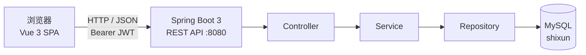

# 书香阁 · 网上书店系统

一个基于 **Spring Boot 3 + Vue 3** 的前后端分离网上书店示例项目，覆盖「浏览图书 → 加入购物车 → 结算支付 → 订单跟踪 → 会员成长」的完整购物闭环，并配套管理员运营后台。


> 本项目用于学习与实训，支付、会员成长等部分功能为演示实现，详见文末「已知限制」。

## 功能特性

**前台商城**

- 🏠 首页门户：品牌 Hero、分类导航、精选图书、销量排行、猜你喜欢、随机名言
- 📖 图书浏览与搜索：按分类筛选、书名 / 作者 / ISBN 模糊搜索、分页
- 📚 图书详情：封面预览、简介、目录、标签、书评评分、读书笔记
- 🛒 购物车：勾选结算、数量修改、重复加购累加、实时合计
- 📦 下单与支付：收货地址管理、会员折扣、满 99 免运费、支付宝 / 微信扫码（模拟）
- 🧾 订单中心：订单列表、详情、状态跟踪
- ⭐ 社区互动：书评与星级评分、收藏、笔记、点赞

**个人中心与会员体系**

- 👤 个人资料、修改密码、资产概览
- 📅 每日签到：连续签到奖励积分，连续 7 天解锁抽奖转盘
- 💎 积分中心、优惠券领取与试算
- 🔔 消息中心、排行榜（销量 / 评分 / 新书）
- 🌙 深色模式、图片懒加载、骨架屏、页面动画

**管理员后台**

- 📊 数据概览：用户数、订单状态分布、总营收、低库存预警、最近订单
- 📕 书籍管理：上架 / 编辑 / 删除、搜索筛选、批量调价
- 🚚 订单管理：发货、完成、取消（恢复库存）
- 👥 用户管理：角色切换、订单数查看

## 技术栈

| 层次 | 技术 |
| --- | --- |
| 后端 | Java 17、Spring Boot 3.5、Spring MVC、Spring Data JPA（Hibernate）、Spring Security |
| 鉴权 | JWT（JJWT 0.12.5）、BCrypt 密码加密 |
| 数据库 | MySQL 8.x（JPA 自动建表） |
| 前端 | Vue 3.5（组合式 API）、Vite 8（Rolldown）、Vue Router 5、Element Plus 2.14、Axios |
| 体验 | 自建设计系统（深夜书房）、真实图书封面（缺失时回退程序化书封）、自定义懒加载指令 |
| 构建 | Maven Wrapper、npm |

## 系统架构



- 前端开发端口 `5173`，后端 API 端口 `8080`；
- 登录态保存在 `localStorage`，请求通过 `Authorization: Bearer <token>` 携带；
- 后端无状态，`JwtAuthenticationFilter` 解析 Token 并写入 `SecurityContext`。

## 目录结构

```text
.
├── docs/                 # 项目文档
│   ├── 项目介绍.md
│   └── 开发文档.md
├── springboot/           # 后端模块（Spring Boot）
│   └── src/main/java/com/example/bookstore/
│       ├── config/       # CORS、启动数据初始化
│       ├── controller/   # REST 控制器
│       ├── dto/          # 请求 / 响应模型
│       ├── entity/       # JPA 实体
│       ├── exception/    # 全局异常处理
│       ├── repository/   # 数据访问
│       ├── security/     # JWT 与 Spring Security
│       └── service/      # 业务服务
├── vue/                  # 前端工程（Vue 3 + Vite）
│   ├── public/covers/    # 图书封面（文件名 = ISBN）
│   └── src/
│       ├── api/          # Axios 封装与业务 API
│       ├── components/   # 公共组件
│       ├── router/       # 路由与守卫
│       ├── styles/       # 主题变量与动画
│       └── views/        # 页面
├── scripts/              # 工具脚本（fetch-book-covers.mjs 抓取封面）
├── .github/workflows/    # CI（后端/前端构建）
├── .editorconfig
├── pom.xml               # Maven 聚合 POM
└── mvnw / mvnw.cmd       # Maven Wrapper
```

## 快速开始

### 环境要求

- JDK 17+
- MySQL 8.x
- Node.js 18+（建议 20 LTS）

### 1. 创建数据库

```sql
CREATE DATABASE IF NOT EXISTS shixun
  DEFAULT CHARACTER SET utf8mb4
  COLLATE utf8mb4_unicode_ci;
```

数据表由 Hibernate 启动时自动创建，无需手动建表。

### 2. 配置数据库连接

编辑 [`springboot/src/main/resources/application.yml`](springboot/src/main/resources/application.yml)，将 `spring.datasource` 的地址、账号、密码改为本地环境的值。

### 3. 启动后端

```bash
cd springboot
../mvnw spring-boot:run
# Windows CMD: ..\mvnw.cmd spring-boot:run
```

启动成功后 API 位于 `http://localhost:8080`。首次启动会自动写入 6 个分类和百余本示例图书。

### 4. 启动前端

```bash
cd vue
npm install
npm run dev
```

浏览器访问 `http://localhost:5173`。

### 5. 创建管理员账号

系统不会自动生成管理员。推荐把已注册用户的角色直接改为管理员：

```sql
UPDATE users SET role = 'ADMIN', discount = 1.00 WHERE account = '你的账号';
```

也可以通过环境变量 `BOOKSTORE_ADMIN_SECRET` 启用管理员注册：启动后端前设置该变量，并在注册请求中携带相同的 `adminSecret`。未配置时注册接口无法创建管理员：

```bash
curl -X POST http://localhost:8080/api/auth/register \
  -H "Content-Type: application/json" \
  -d '{"account":"admin","username":"管理员","password":"123456","email":"admin@example.com","phone":"","adminSecret":"与 BOOKSTORE_ADMIN_SECRET 相同的值"}'
```

之后通过 `http://localhost:5173/admin-login` 登录后台。

## 文档

- 📘 [项目介绍](docs/项目介绍.md)：功能清单、技术栈、架构与快速开始
- 📗 [开发文档](docs/开发文档.md)：配置、分层设计、数据模型、完整 API 清单、核心流程、部署指南、技术债

## 已知限制

本项目定位为学习 / 实训示例：

- 支付为**模拟流程**：二维码为静态图片，点击「完成支付」直接更新订单状态，未接入真实支付网关；
- 会员中心的成长值、累计消费等为前端静态展示数据；
- 优惠券可领取与试算，但尚未接入结算抵扣；
- 首页 Banner 接口已实现，页面暂未渲染；
- `application.yml` 中的数据库密码与 JWT 密钥为开发默认值，**部署前务必替换**；
- 公开充值接口已移除，余额仅保留演示用途。

更完整的问题清单与改进建议见[开发文档 · 已知问题与技术债](docs/开发文档.md#12-已知问题与技术债)。

## 说明

本项目仅用于学习交流。示例图书信息、评分与简介等数据仅作演示用途。

图书封面图片来源于豆瓣读书公开页面，仅用于学习演示，版权归原作者及出版社所有。